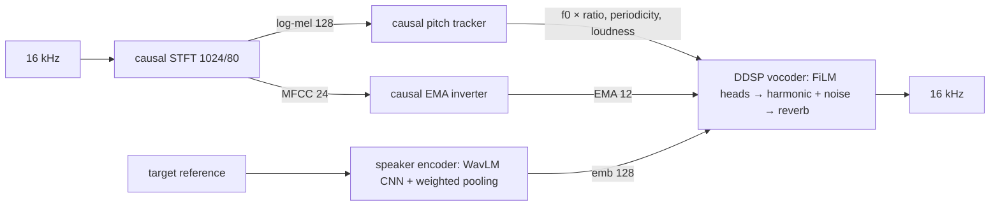

# RT-VC reconstruction: paper / official code → aivoice code

**Status:** PARTIAL_OFFICIAL_CODE: the model layout follows the official classes and is verified to match
them parameter-for-parameter. Training, streaming and the front-end are aivoice code. Architecture
confidence **MEDIUM**. Weights: **NONE**. The authors released none, and nothing has been trained by aivoice yet.

Paper: *RT-VC: Real-Time Zero-Shot Voice Conversion with Speech Articulatory Coding*, ACL 2025 System
Demonstrations (arXiv 2506.10289). Official code: github.com/Berkeley-Speech-Group/RT-VC @ `9d9a55d`.

**License:** the official repository has **no LICENSE** file, so all rights are reserved by default.
aivoice therefore does not copy or vendor any of its files. The modules here are an independent
implementation of the published layout. `eval/official_parity.py` imports the official classes from
*your own* checkout only to compare parameter shapes.

## What exists officially and what is missing

| part | official repo | aivoice |
|---|---|---|
| model classes (pitch tracker, EMA inverter, speaker encoder, DDSP vocoder) | yes | `model/*`, same layout (parity: identical shapes and counts) |
| `realtime_forward` helpers (left context, carried tails) | partial, hidden module state | explicit per-session state, every layer (`streaming/`) |
| streaming loop / audio I/O | no | `streaming/inference.py` + aivoice live pipeline |
| training code, configs, losses | no | `train/*` (this reconstruction) |
| weights | no | trained by the user (`aivoice/rtvc-paper-repro-v0.1`) |
| license | none | aivoice code Apache-2.0; official code not redistributed |

## Map

| source | statement | module | confidence |
|---|---|---|---|
| official `infer_utils.VC` | 16 kHz, framesize 80 (200 Hz) | `config.SAMPLE_RATE/FRAME` | HIGH (verified) |
| official `ema_inverter` | MFCC 24 (n_fft 1024, 128 htk mels, hop 80) → causal conv net (conv-BN-ReLU, 3 blocks × dilations 1/3/9, conv) → 3-layer MLP → 12 EMA | `model/frontend.py`, `model/encoder.EMAInverter` | HIGH (layout); sizes MEDIUM |
| official `pitch_tracker` | mel 128 → causal conv net → pitch-bin logits (sigmoid), periodicity (sigmoid), loudness (8·sigmoid); decode = weighted mean of 9 bins around the argmax | `model/encoder.PitchTracker` | HIGH (layout, decoding); bins/range LOW |
| official `vocoder/encoder` | input [f0/500, loudness, periodicity, EMA] (15 ch) → causal conv net → FiLM MLP heads: sin/cos harmonic banks (nh+1 each) and noise filter H (257 bands); DDSP scaled sigmoid; attenuate 0.01 | `model/decoder.DDSPVocoder` | HIGH |
| official `harmonic.py` | softmax harmonic distribution, anti-alias mask, sin + cos oscillator banks, Hann OLA upsampling (realtime path) | `model/decoder._synth` | HIGH |
| official `noise.py` | LTV-FIR noise: irfft(H), roll to linear phase, Hann window, per-frame conv + OLA | `model/decoder._synth` | HIGH |
| official `vocoder.py` | reverb: MLP(speaker emb) → 1025-tap FIR, causal convolution | `model/decoder._synth` | HIGH |
| official `vocoder/encoder.SpeakerEncoder` | WavLM-large CNN feature extractor → dilated conv encoder → periodicity-weighted mean (+std) pooling → MLP (128) | `model/timbre.py` | HIGH (layout); conv sizes LOW |
| official `VC.vc` | f0 × (median_tgt / median_src) | `model/rtvc.py` | HIGH (offline); streaming R-S1 |
| paper abstract | 61.4 ms latency on CPU | `info.py` notes | PAPER-REPORTED |

## Assumptions and deviations

| id | what | choice | why |
|---|---|---|---|
| R-F1 | front-end | **causal** STFT: frame t = samples [80(t+1)−1024, 80(t+1)) | the official helpers centre the STFT (32 ms lookahead); real zero lookahead needs training with the causal front-end |
| R-F2 | f0 upsampling | causal Hann OLA for f0 too, in training and inference | official offline: linear interpolation (lookahead); official realtime: Hann OLA. Train ≡ run |
| R-F3 | pitch-tracker input | log-mel instead of linear mel power | scale robustness; the official input normalisation is unknown |
| R-T1 | EMA pseudo-labels | SPARC articulatory inversion, 50 → 200 Hz linear | RT-VC builds on speech articulatory coding; the repo has no training code |
| R-P1 | pitch / periodicity targets | aivoice YIN (or a cache you supply, e.g. CREPE), Gaussian-blurred bins (σ 1.5 bins) for BCE | teacher unspecified |
| R-P2 | pitch tracker sizes | hidden 256, 256 bins, 50–800 Hz, base 440 | no configs released |
| R-S1 | streaming source median | from enrolling the user's own voice (`enroll(source_16k=…)`) or a fixed value | the official median is computed over the whole file (offline) |
| R-S2 | speaker conv encoder | 512 wide, dilations (1,2,4,8) × 2 stacks, mean+std | no configs released |
| R-A1 | augmentation | ±6 dB gain, white noise at 20–50 dB SNR on tracker inputs (p = 0.5) | robustness; not specified |
| R-L1 | vocoder loss | DDSP multi-scale spectral (FFT 2048…64, L1 lin + log), lr 1e-3 | DDSP recipe; no adversarial loss in the official code |
| R-V1 | speaker-pooling periodicity at training | normalised frame energy proxy | avoids running the tracker inside the vocoder step |

## Streaming (exact)

Per session: front-end buffer (944 samples), conv buffers (pitch, EMA, vocoder encoder), upsampling
tails (81 samples per control channel), oscillator phase (float64, wrapped), noise generator + OLA tail
(2·nbands − 2), reverb tail (1024). 5 ms frames, zero future frames. Streamed output equals the offline
forward to ≤ 2e-5 for any chunking, and the noise generator is per-session and deterministic.

## Training order

`pitch` → `ema` → `vocoder` (teacher-forced controls), then `aivoice reproduce export rtvc` assembles them.
Each stage must pass the tiny-overfit gate. Measured here (CPU, tiny config, synthetic data): pitch 0.08×
and EMA 0.09× of the starting loss after 200 steps (pass); vocoder 0.55× after 400 steps, still
falling (gate **not** passed at that length).
