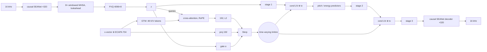

# TVTSyn reproduction: paper / official code → aivoice code

**Status:** PAPER_REPRODUCTION_WITH_ASSUMPTIONS. Architecture confidence: content encoder, VQ and time-varying
timbre **HIGH** (verified against official code, parameter shapes identical); decoder **MEDIUM**.
Weights: **NONE**. The released TVTSyn GTM/decoder weights could not be inspected, and nothing has been
trained by aivoice yet.

Paper: *TVTSyn* (time-varying timbre streaming VC), ICLR 2026, arXiv 2602.09389. Code checked against:
the official **VOSSA** repository (github.com/Morris88826/VOSSA @ `5dd1a5c`, CC BY-NC 4.0), whose README
calls its frozen streaming content encoder "the TVTSyn backbone" and which contains TVTSyn's
`StreamingGlobalOnlyTVTimbre` (704-d global embedding). aivoice *reads* that code to verify numbers. It
copies none of it: the modules here are independent code under Apache-2.0, and
`eval/official_parity.py` imports the official classes from your checkout only to compare parameter
shapes.

## Map

| source | statement | module | status |
|---|---|---|---|
| brief / `pasrwithquant_la4.yaml` | causal SEANet CNN, ratios [8,5,4,2] (applied 2,4,5,8), 64 filters → 512-d @ 50 Hz | `model/encoder.ContentEncoder.cnn` | VERIFIED |
| brief / yaml | 8 MHSA blocks, 8 heads, 2048 FF, context 100, RoPE, layer scale 0.01, **right_context 4** | `ContentEncoder.tf` | VERIFIED (see T-S1) |
| brief / `factorized_vector_quantize.py` | VQ 512 → 8-d → 4096 codes, L2-normalised (cosine), → 512; commitment 0.15, codebook 1.0 | `model/encoder.FactorizedVQ` | VERIFIED (parity: identical shapes) |
| brief / yaml | HuBERT-base layer-9 k-means 200 pseudo-labels, CE | `ContentEncoder.pasr_loss`, `train/preprocess.py` | VERIFIED (num_codes 200) |
| brief / `tv_timbre.py` | Global Timbre Memory: MLP(704→256→2·48·128) + learned K/V priors | `model/timbre.GlobalTimbreMemory` | VERIFIED |
| `tv_timbre.py` | content queries (1×1 conv → 128, RoPE on queries only, absolute offset), 4-head cross-attention to the 48 tokens, token dropout 0.1 | `TimeVaryingTimbre._attend` | VERIFIED (T-R1) |
| brief / `tv_timbre.py` | gate MLP (content → 256 → 1, sigmoid); **Slerp** between normalised attended timbre (192) and projected global embedding | `TimeVaryingTimbre.forward`, `slerp` | VERIFIED (parity: identical shapes) |
| brief | g = x-vector (512) + ECAPA (192) | `config.TimbreConfig.g_dim = 704`, `train/preprocess.SpeakerTeachers` | VERIFIED (dimension) |
| `mel_synthesizer.ProsodyMelSynthesizer` | decoder stages 3 / 3 / 2, conditional LayerNorm + gated fusion after stages 1 and 2, pitch + energy predictors after stage 1 (k 7, dropout 0.1), embeddings added; token-averaged targets in training, predictions at inference | `model/decoder.Decoder` | VERIFIED (layout), T-D3 |
| brief | decoder with KV cache | `common/streaming_nn.Transformer.step` | HIGH |
| brief | upsampling [2,4,5,8] to the waveform | `common/blocks.CausalSEANetDecoder` (×8 ×5 ×4 ×2) | MEDIUM (T-D1) |
| brief | losses 20 mel / 1 adv / 2 FM / 20 F0-energy | `model/losses.generator_loss` | from brief |
| yaml | AdamW, lr 5e-4 (content stage); synth lr 1e-4, betas (0.8, 0.99), γ 0.999996/step | `config.TVTSynConfig` | VERIFIED (VOSSA configs) |
| paper | < 80 ms GPU latency | `info.py` notes | PAPER-REPORTED |

## Findings from the official code (as read by aivoice)

* **T-S1, lookahead.** `right_context: 4` is set for *every* encoder layer. In the offline (training) model
  the lookahead therefore stacks to 8 × 4 = 32 frames (640 ms). The official streaming step
  (`src/streaming/step.py`) buffers only 4 future frames and recomputes the windows, so its streaming
  output can match the offline model only approximately. aivoice does not approximate. The paper preset
  (`tvtsyn-repro`) streams **exactly**, with the true 640 ms delay. The **aivoice variant** (`tvtsyn-aivoice`)
  gives the 4-frame lookahead to the first layer only, which streams exactly at 80 ms but is **not** the paper
  configuration.
* **T-D3, conditional LayerNorm.** The official `CondLNWithFusion` uses `GroupNorm(1, C)` on `[B, C, T]`,
  which normalises over channels *and time*. That makes it non-causal over a training segment, and it
  differs per chunk at streaming time. aivoice normalises each frame over channels (causal; train ≡ stream).
* **T-R1, RoPE.** The official `rope_apply` picks `cos[..., ::2]` from `cat([freqs, freqs])`, so only
  every second frequency is used (repeated). aivoice uses standard RoPE. Shapes are unaffected; values
  differ if official weights were ever loaded.

## Assumptions

| id | what | choice |
|---|---|---|
| T-D1 | waveform decoder | causal SEANet decoder, 64 base filters, one residual unit per stage |
| T-L2 | discriminator | HiFi-GAN MPD + MSD (VOSSA uses a multi-scale *mel* discriminator because it predicts mels) |
| T-P1 | pitch / energy targets | token-averaged log-F0 (YIN, 0 = unvoiced) and log frame RMS, over runs of identical k-means codes |
| T-X1 | timbre reference | x-vector + ECAPA of another utterance of the same speaker |
| T-C1 | training crop | 2 s |

## Ablations (real switches)

`--set timbre.interp=lerp` (normalised linear instead of Slerp), `--set timbre.gate=fixed --set
timbre.fixed_alpha=0.5`, preset `aivoice` (first-layer lookahead). Ablation checkpoints carry the changed config
(their fingerprint differs) and are never named `paper-repro`.

## Diagram (original)

