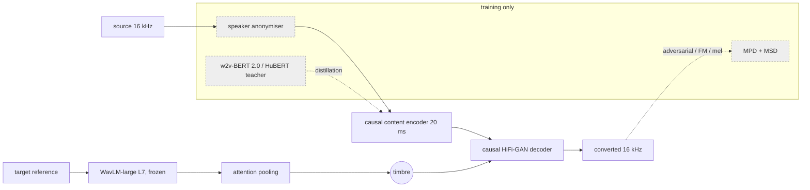

# Zero-VC reproduction: paper → code map

**Status:** PAPER_REPRODUCTION_WITH_ASSUMPTIONS · architecture confidence **MEDIUM** (content student and
SA module **LOW**) · weights: **NONE** (no official weights exist; nothing trained by aivoice yet).

Paper: *Zero-VC: Zero-Lookahead Streaming Voice Conversion via Speaker Anonymization*, Li, Fang, Qiu, Wu
et al., arXiv 2606.20218 (Interspeech 2026). No official code was found (2026-10-21; demo page only).
The paper PDF could not be opened from the build environment, so the facts below come from
search-indexed passages of the paper and its abstract. Anything not confirmed there is an **assumption**
(Z-*), and SPEC readers should re-check it against the full paper.

## What the paper states (as indexed) → where it is

| Paper (section / eq. / fig.) | Statement | aivoice module | Decision | Confidence |
|---|---|---|---|---|
| Abstract, §1 | strictly causal, zero-lookahead, "one-frame-in, one-frame-out" | `streaming/inference.py`, `common/streaming_nn.py` | every layer causal; `future_frames = 0`; 20 ms frame → 320 samples | HIGH |
| §2 (Fig. 1) | pretrained streaming encoder "e.g., a distilled streaming w2v-bert-2.0" | `model/encoder.py` (variant A) | causal student distilled from w2v-BERT 2.0 (L1 + cosine) | LOW (student arch., layer: Z-C1, Z-C2) |
| §2, Eq. 1 | timbre: WavLM-large **layer 7** hidden states, learnable attention pooling → one vector | `model/timbre.py`, `common/blocks.AttentionPooling` | `hidden_states[7]`; softmax(wᵀ tanh(Wh+b)) pooling + projection | HIGH (layer, pooling); MEDIUM (dims: Z-T1) |
| §2 | streaming decoder "mainly based on HiFi-GAN" with modifications for zero lookahead | `model/decoder.py`, `common/blocks.CausalHiFiGAN` | HiFi-GAN V1 with causal convs + causal transposed convs | MEDIUM (Z-D1–Z-D3) |
| §2 | off-the-shelf SA module perturbs the source **during training only** | `model/anonymizer.py` | McAdams (DSP) or user-supplied anonymised copies; never imported at inference | LOW (which SA: Z-A1) |
| §2 / Fig. 1 caption | "the same adversarial framework as HiFi-GAN"; MPD + MSD discarded after training | `model/discriminator.py`, `model/losses.py` | MPD (2,3,5,7,11) + MSD ×3, LSGAN, FM, mel L1 | HIGH (framework); MEDIUM (weights: Z-L1) |
| §3.1 | LibriTTS 585 h; drop < 4 s; 16 kHz → ~460 h | `config.min_utt_s = 4.0`, `train/preprocess.py` | manifest filter `min_duration = 4.0` | HIGH |
| §2 | 20 ms frame shift; chunk-by-chunk every 20 ms | `config.HOP = 320` | encoder strides ∏ = 320 | HIGH |
| §3.3 | SS-S 0.171, SS-R 0.521, WER 3.96 %, RTF 0.063 (Xeon 8468V CPU) | `info.py` notes | **PAPER-REPORTED**, never used for routing or tables of measurements | — |
| ablation | LSCodec features as baseline content (severe leakage) | not reproduced | — | — |

## Assumptions

| id | what | choice | why |
|---|---|---|---|
| Z-C1 | content student architecture | causal SEANet CNN (32 filters, strides 2,4,5,8) → 8-layer causal windowed transformer (512-d, 8 heads, 100-frame window, right context 0) | standard streaming-SSL-student layout; the paper names only the teacher |
| Z-C2 | distilled teacher layer | w2v-BERT 2.0 `hidden_states[16]` (of 24) | middle-upper layers are the most phonetic; not stated |
| Z-C3 | distillation loss | L1 + (1 − cosine) | DistilHuBERT recipe |
| Z-T1 | timbre dimension | 256 (pooling hidden 256) | not stated |
| Z-T2 | timbre reference during training | 3 s crop of *another* utterance of the same speaker | standard zero-shot VC; reduces copy-through |
| Z-D1 | upsampling | (8,5,4,2), kernels 2·rate | HiFi-GAN V1 uses (8,8,2,2) for hop 256; 320 needs another factorisation |
| Z-D2 | causal transposed conv | full transposed conv, right overhang trimmed, overlap carried as state | the standard exact causal form |
| Z-D3 | timbre conditioning | linear(timbre) added before each upsampling stage | not stated; global conditioning as in many HiFi-GAN VC decoders |
| Z-A1 | SA system | McAdams coefficient α ~ U(0.7, 0.9), LPC order 20, 20 ms frames | DSP, weight-free VoicePrivacy baseline; plug in a neural SA via `anonymized_path` |
| Z-L1 | loss weights / optimiser | mel 45, FM 2, adv 1; AdamW 2e-4, β (0.8, 0.99), decay 0.999 per 1k steps | HiFi-GAN defaults |
| Z-S1 | training crop | 2 s | not stated |

## Variants

* **A, closest paper reproduction:** content student distilled from w2v-BERT 2.0.
* **B, aivoice practical variant (NOT the paper):** the same student trained with cross-entropy on HuBERT-base
  layer-9 k-means-200 codes, the TVTSyn content recipe. Its teacher is smaller, and discrete targets leak less
  timbre. Weights are named `aivoice/zerovc-variantB-v0.1` so they can't be mistaken for variant A.

## Diagram (original, not the paper's figure)

At inference SA, discriminators and teachers are absent. WavLM runs once per target voice, and the
pooled vector is cached.

## Validation (phases)

* A, architecture: shapes, parameter counts, causal-conv, KV-cache and attention-pooling tests (`tests/reproductions`).
* B, tiny overfit (mandatory before training): content and vc stages on 2 synthetic utterances.
* C, streaming: causality (identical to 5 s), state reset, 20/40/80 ms and irregular chunk invariance, offline parity.
* D, small-data training: user-run (LibriTTS dev subset), then compare against existing engines.
* E, full training: user-run on a GPU. `aivoice reproduce train --profile` measures the cost first.
